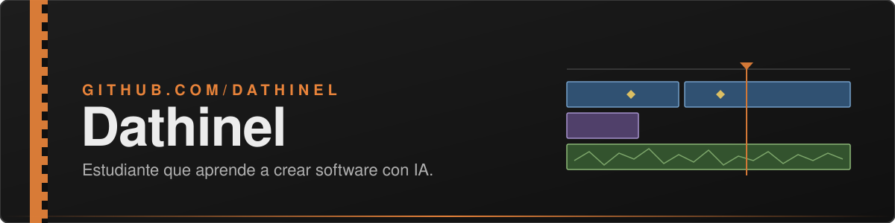
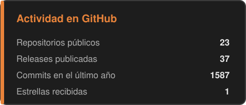
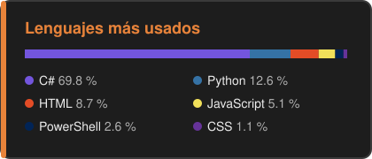

  

  <a href="#rodaje">Rodaje</a> ·
  <a href="#herramientas-de-ia">Herramientas de IA</a> ·
  <a href="#complementos">Complementos</a> ·
  <a href="#lo-próximo">Lo próximo</a> ·
  <a href="#universidad">Universidad</a>

Soy estudiante y estoy aprendiendo a crear software con ayuda de la IA (Claude Code y otros agentes). Aquí publico en código abierto programas para cosas que me gustan y uso, cada uno en su propio repositorio. De otros programas solo tomo ideas, nunca su código ni sus recursos.

Todo es **nativo para Windows**, funciona **sin conexión** y la IA corre **en tu PC**.

## Rodaje

<table>
  <tr>
    <td width="150" align="center" valign="top">
      
    </td>
    <td valign="top">
      <b>Editor de video nativo para Windows.</b> Edición por capas al cuadro exacto, imagen en la GPU (Direct3D 11), títulos y subtítulos, audio con mezcla a LUFS, exportación por GPU e IA local por módulos. Escrito en C# con .NET 10 y WinUI 3; compilado con Native AOT, no necesita .NET instalado.
        
      
      
      
      
      
        
      <a href="https://github.com/Dathinel/rodaje/releases/latest"><b>Descargar</b></a> ·
      <a href="https://github.com/Dathinel/rodaje">Repositorio</a> ·
      <a href="https://github.com/Dathinel/rodaje/blob/main/docs/README.md">Documentación</a>
    </td>
  </tr>
</table>

## Herramientas de IA

Las funciones de IA de Rodaje como programas aparte, cada uno con su propia interfaz y su propia descarga. Usan los mismos módulos que Rodaje y los comparten entre sí: lo que bajas para uno sirve para los demás.

| Herramienta | Qué hace | Versión |
|---|---|---|
| [**Subtitular**](https://github.com/Dathinel/subtitular) | Subtítulos automáticos (SRT y VTT), traducción conservando los tiempos y texto a voz |  |
| [**Rastrear**](https://github.com/Dathinel/rastrear) | Seguimiento de puntos, quitar fondo, rostros y personas, reencuadre y estabilización |  |
| [**Lanzador**](https://github.com/Dathinel/lanzador) | Lista, descarga e instala las herramientas, con firma y huellas comprobadas |  |

Las tres son GPLv3, con interfaz en WinUI 3 y una CLI para guiones.

## Complementos

Rodaje viene completo como editor y exportador; lo demás se instala desde la app (Complementos), que baja cada `.paquete` del [catálogo firmado](https://github.com/Dathinel/rodaje-catalogo)  y comprueba su firma. Cómo se hace: [guía de complementos](https://github.com/Dathinel/rodaje/blob/main/docs/guia/complementos.md).

<b>10 paquetes de contenido</b>: transiciones, looks, fuentes, títulos, sonidos, preajustes y más

 

| Complemento | Qué trae | Versión | Licencia |
|---|---|---|---|
| [rodaje-transiciones](https://github.com/Dathinel/rodaje-transiciones) | 45 transiciones: curvas de movimiento y mezclas de calidad en la GPU |  | CC0 |
| [rodaje-filtros](https://github.com/Dathinel/rodaje-filtros) | 13 looks de color con LUT 3D |  | CC0 |
| [rodaje-fuentes](https://github.com/Dathinel/rodaje-fuentes) | 10 familias tipográficas libres |  | OFL |
| [rodaje-titulos](https://github.com/Dathinel/rodaje-titulos) | 15 estilos de texto, subtítulos y karaoke |  | CC0 |
| [rodaje-zonas](https://github.com/Dathinel/rodaje-zonas) | 12 guías de encuadre para el visor |  | CC0 |
| [rodaje-camaras](https://github.com/Dathinel/rodaje-camaras) | 9 LUT de log de cámara a Rec. 709 |  | CC0 |
| [rodaje-sonidos](https://github.com/Dathinel/rodaje-sonidos) | 50 efectos de sonido sintetizados |  | CC0 |
| [rodaje-preajustes-pro](https://github.com/Dathinel/rodaje-preajustes-pro) | 15 preajustes de exportación: ProRes, DNxHR, emisión, cine |  | CC0 |
| [rodaje-360](https://github.com/Dathinel/rodaje-360) | Video 360: reencuadre, pequeño planeta y exportación esférica |  | CC0 |
| [rodaje-codificadores-gpl](https://github.com/Dathinel/rodaje-codificadores-gpl) | x264 y x265 con un ffmpeg.exe GPL propio |  | GPLv3 |

<b>6 módulos de IA local</b>: subtítulos, traducción, voz, audio, visión y RAW

 

| Módulo | Qué hace | Versión | Licencia |
|---|---|---|---|
| [modulo-subtitulos](https://github.com/Dathinel/modulo-subtitulos) | Subtítulos automáticos con Whisper |  | GPLv3 |
| [modulo-traducir](https://github.com/Dathinel/modulo-traducir) | Traducción de subtítulos con Qwen3-4B |  | GPLv3 |
| [modulo-voz](https://github.com/Dathinel/modulo-voz) | Texto a voz con Kokoro-82M |  | GPLv3 |
| [modulo-audio-ia](https://github.com/Dathinel/modulo-audio-ia) | Reducción de ruido y detección de voz |  | GPLv3 |
| [modulo-vision](https://github.com/Dathinel/modulo-vision) | Quitar fondo, rostros y reencuadre automático |  | GPLv3 |
| [modulo-raw](https://github.com/Dathinel/modulo-raw) | Revelado de CinemaDNG con LibRaw |  | GPLv3 |

## Lo próximo

Lo que ya está en el código y saldrá en la siguiente versión de cada herramienta:

- **Subtitular 1.1**: cola de varios archivos (o una carpeta entera), atajos de teclado, guardar sin revisar y aviso de versión nueva.
- **Rastrear 1.1**: cola de videos, vista previa «Después» con los parámetros actuales, carpeta de salida propia, atajos y aviso de versión nueva.
- **Lanzador 1.0 estable**: modo sin conexión, descargas reanudables con velocidad y tiempo restante, y actualizaciones de las herramientas desde la propia ventana.
- **Código compartido**: sacar lo común de las tres herramientas a un paquete propio en vez de copiarlo entre repositorios.

## Universidad

[**Sensores-Teoria**](https://github.com/Dathinel/Sensores-Teoria): prácticas y teoría de sensores y microcontroladores. ESP32 con MicroPython y C++, detección de objetos con OpenCV, control por gestos, brazo robótico simulado, enjambres y laboratorios Docker con MQTT.

## Tecnologías

  

- **Escritorio Windows:** C#, .NET 10, WinUI 3, Native AOT, Direct3D 11 con shaders HLSL, FFmpeg (LGPL) por P/Invoke, ONNX y DirectML para la IA, Inno Setup para los instaladores, PowerShell para construir y distribuir, GitHub Actions como CI.
- **Sensores y microcontroladores:** ESP32 con MicroPython y C++, Python con OpenCV, PyTorch, TensorFlow y Streamlit, laboratorios Docker con MQTT.

## Actividad

  
  

Las tarjetas las genera cada día [un workflow](.github/workflows/estadisticas.yml) de este repositorio. Textos e imágenes de este perfil: [CC BY 4.0](LICENSE). El nombre y el logotipo de Rodaje no se incluyen (ver su [TRADEMARK.md](https://github.com/Dathinel/rodaje/blob/main/TRADEMARK.md)).
