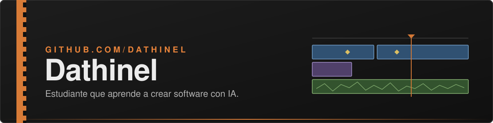

  

Programas propios para Windows, uno por repositorio: compilados de antemano con Native AOT, autocontenidos y sin instalador obligatorio. Todo el código es propio; de otros programas solo se toman ideas de producto.

## Rodaje

<table>
  <tr>
    <td width="150" align="center" valign="top">
      
    </td>
    <td valign="top">
      <b>Editor de video nativo para Windows.</b> Edición por capas al cuadro exacto, imagen en la GPU (Direct3D 11), títulos y subtítulos, audio con mezcla a LUFS, exportación por GPU e IA local por módulos. Escrito en C# con .NET 10 y WinUI 3; compilado con Native AOT, no necesita .NET instalado.
        
      
      
      
      
      
        
      <a href="https://github.com/Dathinel/rodaje">Repositorio</a> ·
      <a href="https://github.com/Dathinel/rodaje/releases">Descargas</a> ·
      <a href="https://github.com/Dathinel/rodaje/blob/main/docs/README.md">Documentación</a> ·
      <a href="#complementos">Complementos</a>
    </td>
  </tr>
</table>

### Complementos

Rodaje viene completo como editor y exportador; lo demás se instala desde la app (Complementos), que baja cada `.paquete` del [catálogo firmado](https://github.com/Dathinel/rodaje-catalogo)  y comprueba su firma. Cómo se hace: [guía de complementos](https://github.com/Dathinel/rodaje/blob/main/docs/guia/complementos.md).

| Complemento | Qué trae | Versión | Licencia |
|---|---|---|---|
| [rodaje-transiciones](https://github.com/Dathinel/rodaje-transiciones) | 45 transiciones: curvas de movimiento y mezclas de calidad en la GPU |  | CC0 |
| [rodaje-filtros](https://github.com/Dathinel/rodaje-filtros) | 13 looks de color con LUT 3D |  | CC0 |
| [rodaje-fuentes](https://github.com/Dathinel/rodaje-fuentes) | 10 familias tipográficas libres |  | OFL |
| [rodaje-titulos](https://github.com/Dathinel/rodaje-titulos) | 15 estilos de texto, subtítulos y karaoke |  | CC0 |
| [rodaje-zonas](https://github.com/Dathinel/rodaje-zonas) | 12 guías de encuadre para el visor |  | CC0 |
| [rodaje-camaras](https://github.com/Dathinel/rodaje-camaras) | 9 LUT de log de cámara a Rec. 709 |  | CC0 |
| [rodaje-sonidos](https://github.com/Dathinel/rodaje-sonidos) | 50 efectos de sonido sintetizados |  | CC0 |
| [rodaje-preajustes-pro](https://github.com/Dathinel/rodaje-preajustes-pro) | 15 preajustes de exportación: ProRes, DNxHR, emisión, cine |  | CC0 |
| [rodaje-360](https://github.com/Dathinel/rodaje-360) | Video 360: reencuadre, pequeño planeta y exportación esférica |  | CC0 |
| [rodaje-codificadores-gpl](https://github.com/Dathinel/rodaje-codificadores-gpl) | x264 y x265 con un ffmpeg.exe GPL propio |  | GPLv3 |
| [modulo-subtitulos](https://github.com/Dathinel/modulo-subtitulos) | Subtítulos automáticos con Whisper |  | GPLv3 |
| [modulo-traducir](https://github.com/Dathinel/modulo-traducir) | Traducción de subtítulos con Qwen3-4B |  | GPLv3 |
| [modulo-voz](https://github.com/Dathinel/modulo-voz) | Texto a voz con Kokoro-82M |  | GPLv3 |
| [modulo-audio-ia](https://github.com/Dathinel/modulo-audio-ia) | Reducción de ruido y detección de voz |  | GPLv3 |
| [modulo-vision](https://github.com/Dathinel/modulo-vision) | Quitar fondo, rostros y reencuadre automático |  | GPLv3 |
| [modulo-raw](https://github.com/Dathinel/modulo-raw) | Revelado de CinemaDNG con LibRaw |  | GPLv3 |

## Tecnologías

  

  
  
  
  
  
  
  
  
  

- **Escritorio Windows:** C#, .NET 10, WinUI 3, Native AOT, Direct3D 11 con shaders HLSL, FFmpeg (LGPL) por P/Invoke, PowerShell para construir y distribuir, GitHub Actions como CI en Windows y Linux.
- **Sensores y microcontroladores** ([Sensores-Teoria](https://github.com/Dathinel/Sensores-Teoria)): ESP32 con MicroPython y C++, Python con OpenCV, PyTorch, TensorFlow y Streamlit, laboratorios Docker con MQTT.

## Actividad

  
  

Textos e imágenes de este perfil: [CC BY 4.0](LICENSE). El nombre y el logotipo de Rodaje no se incluyen (ver su [TRADEMARK.md](https://github.com/Dathinel/rodaje/blob/main/TRADEMARK.md)).
